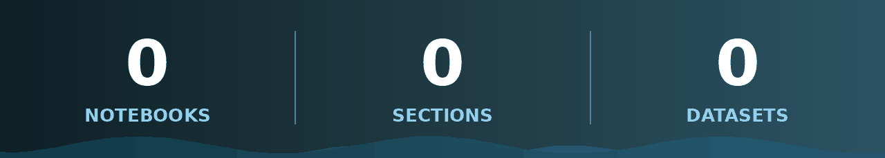

<div align="center">


[](https://github.com/AdnanCodex/ai-engineering-notes)


</div>

<div align="center">


</div>

> ### 🎯 *"Theory tells you what might work. These notebooks show you what actually runs."*
>
> A structured, hands-on knowledge base of my AI engineering journey — every concept learned by building it, every notebook runnable, every output saved.

<div align="center">


</div>

## 📑 Table of Contents

- [🌟 Why This Repository](#-why-this-repository)
- [🗂️ The Six Sections](#️-the-six-sections)
- [🗺️ Roadmap](#️-roadmap)
- [📊 Repository at a Glance](#-repository-at-a-glance)
- [🧰 Tech Stack](#-tech-stack)
- [🗃️ Repository Structure](#️-repository-structure)
- [⚡ Getting Started](#-getting-started)
- [📌 How This Repo Is Organized](#-how-this-repo-is-organized)
- [👤 Author](#-author)

<div align="center">


</div>

## 🌟 Why This Repository


| | |
| --- | --- |
| 🧭 **One path, zero chaos** | Six numbered sections take you from Python basics to Generative AI in the exact order to learn them |
| 💻 **Code first** | 36 notebooks — not slides, not theory dumps. Real datasets, real models, real results |
| 🏆 **Model selection built in** | Every ML topic ends with a full comparison notebook: cross-validation + hyperparameter tuning + leaderboard |
| 👁️ **Readable without running** | All outputs (tables, charts, scores) are saved — browse everything right here on GitHub |
| 🔌 **Clone & run** | Dataset paths are repo-relative — clone it and everything executes as-is |
| 📈 **Grows weekly** | New sections unlock as the journey progresses: Deep Learning → Generative AI → FastAPI → Streamlit |

<div align="center">


</div>

## 🗂️ The Six Sections


| # | Section | What it covers | Status |
| --- | --- | --- | --- |
| 01 | 📗 [**Python for Data Science**](01-python-for-datascience/) | Python, NumPy, Pandas, Visualization, Data Cleaning, EDA | ✅ **Complete** |
| 02 | 🤖 [**Machine Learning**](02-machine-learning/) | Preprocessing, Regression, Classification, Ensembles, Clustering | ✅ **Complete** |
| 03 | 🧠 [**Deep Learning**](03-deep-learning/) | Neural networks, CNNs, RNNs, Transformers | 🔜 *Coming soon* |
| 04 | ✨ [**Generative AI**](04-generative-ai/) | LLMs, RAG, AI Agents, prompt engineering | 🔜 *Coming soon* |
| 05 | ⚡ [**FastAPI**](05-fastapi/) | Production-grade APIs for ML models | 🔜 *Coming soon* |
| 06 | 🎈 [**Streamlit**](06-streamlit/) | Interactive dashboards & ML web apps | 🔜 *Coming soon* |

### 📗 Section 01 — Python for Data Science
The foundation layer: **Python programming → NumPy → Pandas (6 notebooks) → Matplotlib & Seaborn → Data Cleaning → Titanic EDA**. Comes with its own detailed README, image assets, dataset notes and `requirements.txt`.

### 🤖 Section 02 — Machine Learning
The complete classical ML path on three real datasets (**Diabetes, Concrete Strength, HR**): **Data Preprocessing → Regression → Classification → Ensemble Learning → Unsupervised Learning** — 24 notebooks, each topic closed by a best-model-selection benchmark.

<div align="center">


</div>

## 🗺️ Roadmap


```
flowchart LR
    A["📗 Python for<br/>Data Science"] --> B["🤖 Machine<br/>Learning"]
    B --> C["🧠 Deep<br/>Learning"]
    C --> D["✨ Generative AI<br/>& Agents"]
    D --> E["⚡ FastAPI"]
    E --> F["🎈 Streamlit"]
    style A fill:#1f7a4d,color:#fff,stroke:#33adff,stroke-width:2px
    style B fill:#1f7a4d,color:#fff,stroke:#33adff,stroke-width:2px
    style C fill:#203a43,color:#fff,stroke:#33adff
    style D fill:#203a43,color:#fff,stroke:#33adff
    style E fill:#203a43,color:#fff,stroke:#33adff
    style F fill:#203a43,color:#fff,stroke:#33adff
```

> ✅ Green = complete &nbsp;•&nbsp; 🌑 Dark = on the roadmap

<div align="center">


</div>

## 📊 Repository at a Glance

<div align="center">



</div>

**🗄️ Datasets included:** Diabetes • Concrete Strength • HR

- **Section 01:** 12 notebooks — Python (1) • NumPy (1) • Pandas (6) • Visualization (2) • Data Cleaning (1) • EDA (1)
- **Section 02:** 24 notebooks — Preprocessing (2) • Regression (5) • Classification (6) • Ensemble (4) • Unsupervised (7)

<div align="center">


</div>

## 🧰 Tech Stack


| Category | Tools |
| --- | --- |
| 🐍 **Language** | Python 3 |
| 🔢 **Data** | NumPy, Pandas |
| 🤖 **Machine Learning** | scikit-learn (regression, classification, ensembles, clustering, tuning) |
| 📈 **Visualization** | Matplotlib, Seaborn |
| 📓 **Environment** | Jupyter Notebook / JupyterLab |
| 🛠️ **Workflow** | Git, GitHub, VS Code |
| 🔭 **On the roadmap** | TensorFlow / PyTorch, LangChain, FastAPI, Streamlit |

<div align="center">


</div>

## 🗃️ Repository Structure

```
ai-engineering-notes/
├── 📄 README.md                     ← you are here
├── 📁 assets/                       🎬 Animated banner, dividers & footer
├── 📁 01-python-for-datascience/    ✅ Python, NumPy, Pandas, Viz, Cleaning, EDA
├── 📁 02-machine-learning/          ✅ Preprocessing → Regression → Classification → Ensemble → Clustering
├── 📁 03-deep-learning/             🔜 placeholder
├── 📁 04-generative-ai/             🔜 placeholder
├── 📁 05-fastapi/                   🔜 placeholder
└── 📁 06-streamlit/                 🔜 placeholder
```

<div align="center">


</div>

## ⚡ Getting Started

```bash
# 1️⃣ Clone the repository
git clone https://github.com/AdnanCodex/ai-engineering-notes.git
cd ai-engineering-notes

# 2️⃣ Install dependencies (Python section requirements cover the core stack)
pip install -r 01-python-for-datascience/requirements.txt

# 3️⃣ Launch Jupyter and pick any section
jupyter lab
```

No path editing, no missing files — **clone it and it runs.**

<div align="center">


</div>

## 📌 How This Repo Is Organized

1. **Sections are numbered** — `01` → `06` is the learning order. Always move forward, never sideways.
2. **Section READMEs go deep** — this page is the map; each section's own README is the guide.
3. **Datasets live with their notebooks** — nothing external to download for completed sections.
4. **Outputs stay saved** — what you see on GitHub is what the code produces.

<div align="center">


</div>

## 👤 Author


<div align="center">

### ✨ **Muhammad Adnan** ✨
*BS Artificial Intelligence • AI Engineer in the making*
*Machine Learning • Deep Learning • Generative AI • AI Agents*

[](https://github.com/AdnanCodex)
[](https://www.linkedin.com/in/adnan-ai)
[](mailto:adnan906132@gmail.com)

</div>

<div align="center">


</div>

<div align="center">


</div>
